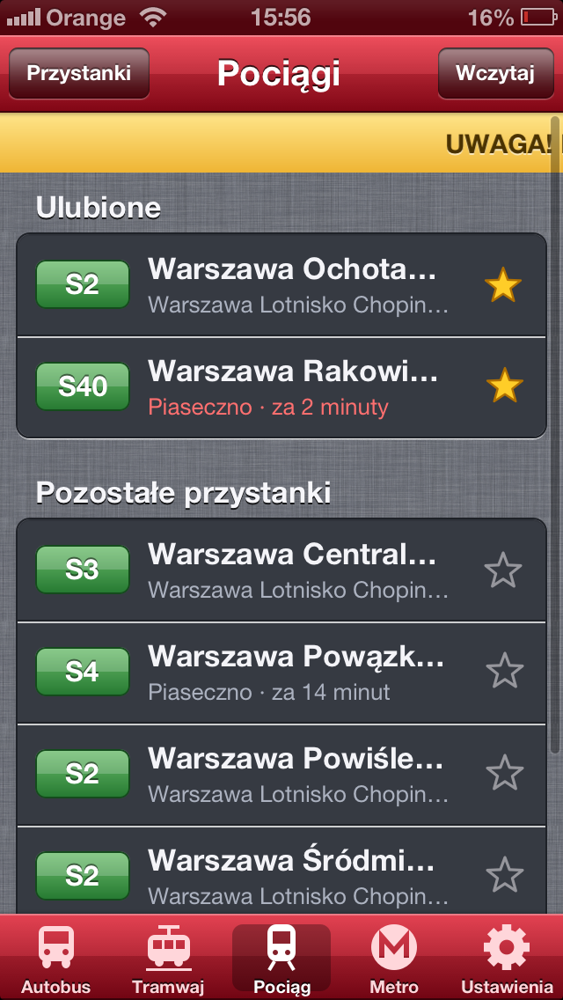
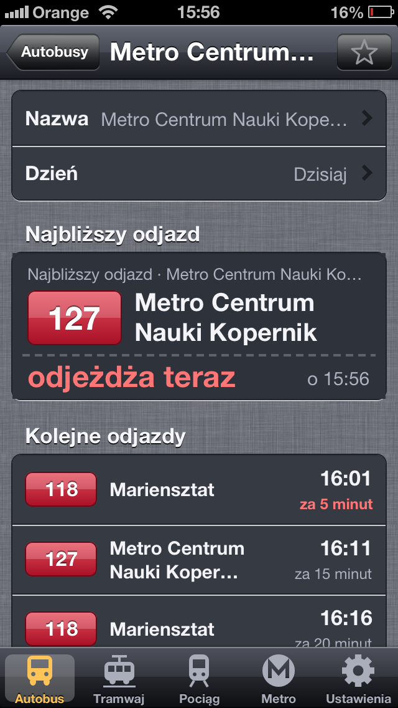

# Rozkład

Aplikacja Rozkład pozwala załadować rozkład jazdy autobusów, tramwajów, pociągów i metra na telefon z iOS 6.x.x.
Miasta: Warszawa, Gdańsk, Kraków, Boston (kolejne w przygotowaniu).

Aplikacja działa offline\*.

\* Miasto i przystanki wybiera się w aplikacji (Wczytaj → Wybierz miasto i przystanki), potrzebny jest do tego internet tylko podczas pobierania.

  
  

## Funkcje

- Nadanie własnej nazwy konkretnemu przystankowi
- Zmiana języka (polski, angielski, rosyjski)
- Zmiana motywów (Grafit, Czerwony, Skóra i Klasyczny)
- Przypomnienia o odjazdach
- oraz inne funkcje

## Instalacja

Zalecam instalację przez plik `.ipa` (**wymagany AppSync Unified!**), natomiast plik `.deb` również jest dostępny.

Repozytorium do Cydii zostanie niedługo upublicznione.

## Dane

- Warszawa: ZTM Warszawa, udostępnia [mkuran.pl](https://mkuran.pl)
- Gdańsk: ZTM Gdańsk, licencja CC BY 4.0
- Kraków: ZTP Kraków
- Boston: MBTA / MassDOT (dane udostępnione na licencji MassDOT Developers License; MBTA nie sponsoruje aplikacji ani jej nie poleca)

## Autor

nazar0vsky (lub slam0)

Aplikacja zrobiona w 95% przez Claude AI.
